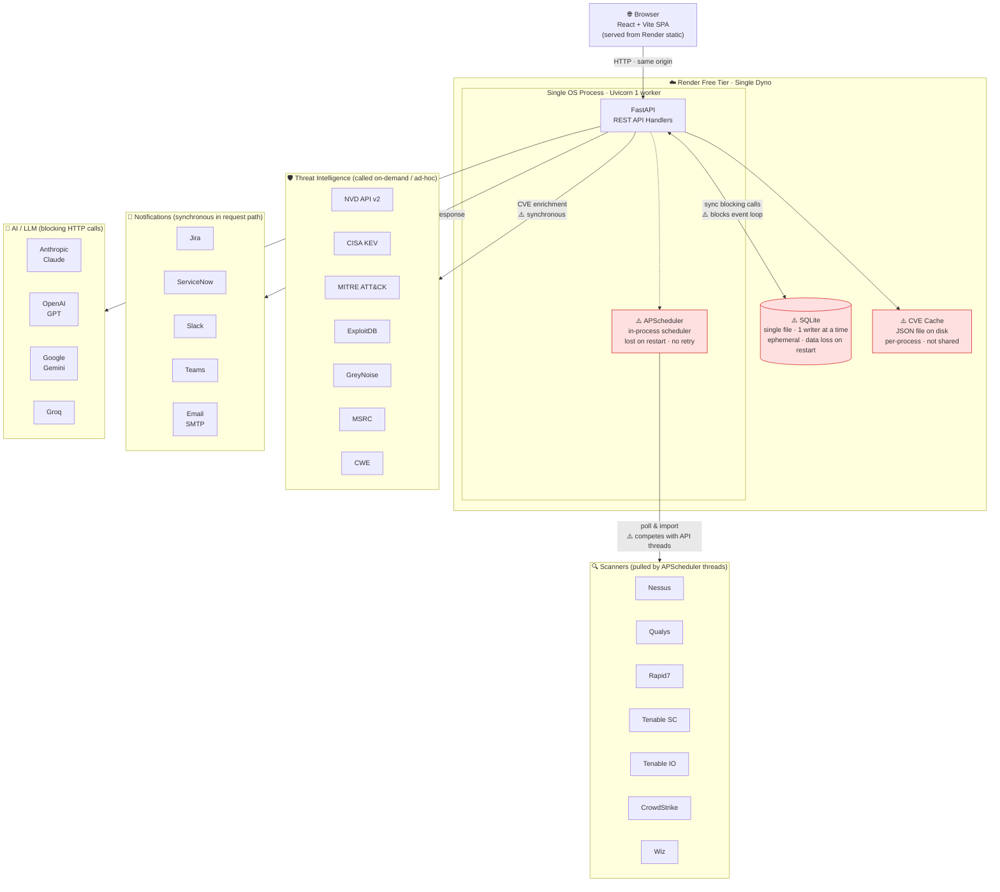
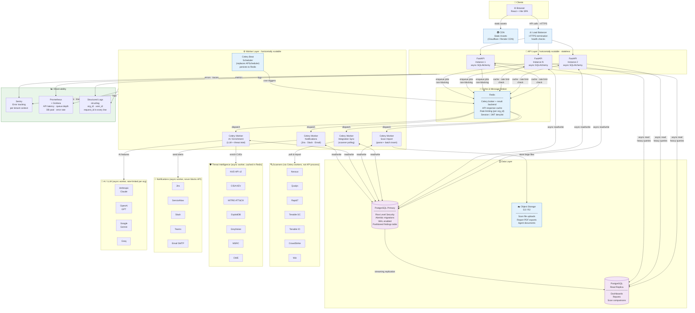

# Architecture: Before & After

---

## BEFORE — Current State

Single-process, single-file, single-dyno deployment on Render free tier.

### Key Problems

| Component | Problem |
|---|---|
| SQLite | 1 writer — lock contention at 10+ customers with concurrent imports |
| APScheduler | In-process — 300 customers × N integrations = thread pool exhaustion |
| Render Free | 15-min spin-down, no persistent disk, data loss on restart |
| DB calls | Sync in async handlers — blocks event loop under load |
| No Redis | No caching layer, no rate limiting, no shared state across instances |
| No queue | Notifications and LLM calls block the HTTP response |
| No observability | Zero metrics, no error tracking, blind to production issues |

---

## AFTER — Target State

Horizontally scalable API + decoupled worker layer + PostgreSQL with read replica.

### What Changed

| Layer | Before | After |
|---|---|---|
| **Frontend** | Render static (cold start) | CDN-served, instant globally |
| **API** | 1 process, 1 worker, sync DB | N stateless instances, async SQLAlchemy |
| **Scheduler** | APScheduler in-process | Celery Beat → Redis → Workers |
| **Jobs** | Blocking API threads | Isolated Celery workers per job type |
| **Database** | SQLite, 1 writer, ephemeral | PostgreSQL, RLS, Alembic, partitioned |
| **Read queries** | Same DB for OLTP + reports | Read replica for dashboards/reports |
| **Files** | SQLite / local disk | S3/R2 object storage |
| **Cache** | JSON file per-process | Redis, shared across all instances |
| **Rate limiting** | None | Redis-backed per `org_id` |
| **Notifications** | Blocks HTTP response | Async Celery worker |
| **LLM calls** | Blocks HTTP response | Async Celery worker, per-org queued |
| **Observability** | Audit log only | Sentry + Prometheus + structured logs |
| **Tenant isolation** | App-level `org_id` filter | PostgreSQL RLS enforced at DB layer |
